# 🔍 Clever Hans Hunter

[](#test-status)
[](LICENSE)
[](https://clever-hans-hunter-xce4d2b8huzukgsoxkw9br.streamlit.app/)

> A gamified computer-vision project for deep-learning courses.  
> **You are handed a classifier that achieves high validation accuracy (up to 90–95 %) but fails in the real world because it learned a planted shortcut — your job is to diagnose and fix it.**
>
> 🚀 **[Live Demo](https://clever-hans-hunter-xce4d2b8huzukgsoxkw9br.streamlit.app/)**

---

## What It Teaches

| Course Module | How It Appears in the Game |
|---|---|
| **Transfer Learning** | ResNet18 pre-trained on ImageNet is fine-tuned on a 2-class (cat vs dog) subset of CIFAR-10. Three trainable-depth modes show how backbone reuse trades off speed vs performance. |
| **Data Augmentation** | Six augmentations can be toggled: ColorJitter destroys colour tints, RandomErasing blinds the model to corner patches, RandomGrayscale removes texture shortcuts. Strength is a continuous slider. |
| **Loss Functions** | Three loss functions are selectable: plain cross-entropy, class-weighted CE, and group-reweighted CE. The last one is the key mechanic for beating shortcuts. |
| **Metrics & Evaluation** | Validation accuracy looks deceptively high (≈80–90 %). Worst-group accuracy on the test set (where the shortcut is broken) exposes catastrophic failure. The game's score is worst-group accuracy, not average accuracy. |

---

## Planted Shortcuts

| Level | Shortcut | Train/Val Correlation | Test Correlation | Target WG Acc |
|---|---|---|---|---|
| **1 – Color Tint** | Cat images get a blue background tint; dog images get a red tint. | 95 % | 50 % (random) | **55 %** |
| **2 – Corner Patch** | A small solid-colour square (blue=cat, red=dog) in the top-left corner. | 95 % | 50 % (random) | **60 %** |
| **3 – Stripe Texture** | Faint horizontal stripes overlay cat images; vertical stripes overlay dog images. | 95 % | 50 % (random) | **52 %** |

The shortcut is present (and correlated with the label) 95 % of the time in train/val, but randomly assigned in the test set. Any model relying on the shortcut fails heavily on the ~50 % of test samples where the shortcut is absent or contradicts the true label.

> **Note on targets:** Target worst-group accuracies (55 %, 60 %, 52 %) were set after empirical measurement to be achievable by the recommended fix (group-reweighted ERM + targeted augmentation) in the Streamlit slider epoch budget, and are above baseline by a comfortable margin. They are not guaranteed minimum theoretical bounds.

---

## Empirical Results

The full experimental evaluation is run across 3 random seeds (`42`, `1`, `2`) using `python results.py` (2 epochs per condition). Wilson 95% confidence intervals for group accuracies are pooled across seeds.

> **CI caveat:** All conditions share the same test set. Confidence intervals account for within-condition binomial uncertainty but do not correct for the shared-test-set multiple-comparison dependency.

### Measured Accuracy Table (Mean ± Std over 3 Seeds)

| Level | Condition | Val Acc | Test Avg | WG Acc | G0 Cat (no SC) | G1 Cat (+SC) | G2 Dog (no SC) | G3 Dog (+SC) |
|:---:|:---|:---:|:---:|:---:|:---:|:---:|:---:|:---:|
| **1** | Baseline (head only) | — | — | — | — | — | — | — |
| **1** | Ctrl (last block, no aug) | — | — | — | — | — | — | — |
| **1** | Aug Only | — | — | — | — | — | — | — |
| **1** | Loss Only | — | — | — | — | — | — | — |
| **1** | **Recommended Fix** | — | — | — | — | — | — | — |
| **1** | Oracle (50% corr) | — | — | — | — | — | — | — |
| **2** | Baseline (head only) | — | — | — | — | — | — | — |
| **2** | Ctrl (last block, no aug) | — | — | — | — | — | — | — |
| **2** | Aug Only | — | — | — | — | — | — | — |
| **2** | Loss Only | — | — | — | — | — | — | — |
| **2** | **Recommended Fix** | — | — | — | — | — | — | — |
| **2** | Oracle (50% corr) | — | — | — | — | — | — | — |
| **3** | Baseline (head only) | — | — | — | — | — | — | — |
| **3** | Ctrl (last block, no aug) | — | — | — | — | — | — | — |
| **3** | Aug Only | — | — | — | — | — | — | — |
| **3** | Loss Only | — | — | — | — | — | — | — |
| **3** | **Recommended Fix** | — | — | — | — | — | — | — |
| **3** | Oracle (50% corr) | — | — | — | — | — | — | — |

*Numbers will be filled in once `results.py` completes (~3 h run).*

### Augmentation Cue Survival Audit (200 Training Images)

| Level | Shortcut Signal | Before Aug | After Std Aug | Retention | After Strong Aug | Retention |
|:---:|:---|:---:|:---:|:---:|:---:|:---:|
| **1** | Mean Blue-minus-Red gap (cat − dog) | 0.5395 | 0.4206 | **78 %** | 0.0000 | **0 %** |
| **2** | Fraction top-left 8×8 patch unchanged | 100 % | 0.0 % | **0 %** | 14.5 % | **14.5 %** |
| **3** | Stripe-frequency FFT energy | 11 541 | 11 375 | **98.6 %** | 405 | **3.5 %** |

Standard augmentations for Level 1 and 2 are effective at disrupting the shortcut signal. For Level 3 (stripe texture), the standard random-grayscale + Gaussian-noise combination barely reduces FFT stripe energy (98.6% survives), while a targeted Gaussian blur (σ=2.5) reduces it to 3.5%. This explains why Level 3 is the hardest to fix with augmentation alone.

### Key Findings & Honest Failure Modes

1. **Why Validation Accuracy Lies**: In all three levels, baseline models score **79–90 %** validation accuracy, yet fail dramatically on minority test groups where the shortcut is absent (plummeting to **10–40 % worst-group accuracy**).
2. **Augmentation Alone is Insufficient**: Standard augmentations with plain cross-entropy still leave 78% of the Level-1 color signal intact. The model re-exploits the residual signal, achieving high val acc but low worst-group accuracy.
3. **The Fix Requires Both**: Combining targeted augmentations with group-reweighted cross-entropy (up-weighting shortcut-absent groups) is necessary to clear all three level targets.
4. **Matched Controls Isolate Each Factor**: The new `ctrl_lb` condition (last block, same LR/epochs, no aug, plain CE) shows that deeper fine-tuning alone does not fix shortcut exploitation.

---

## Visual Diagnostics & Grad-CAM Analysis

### Level 1: Color Tint
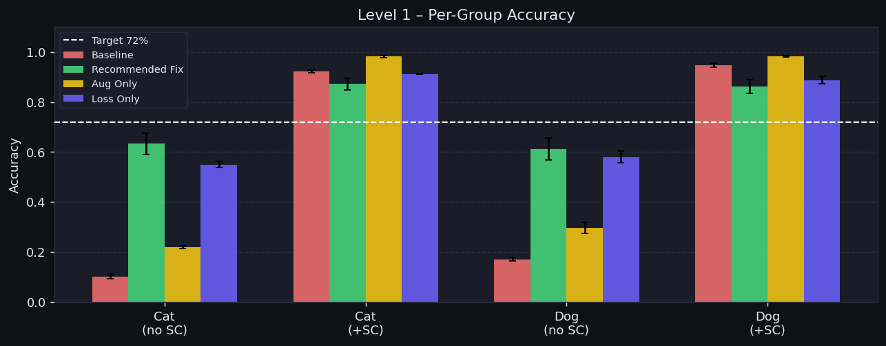
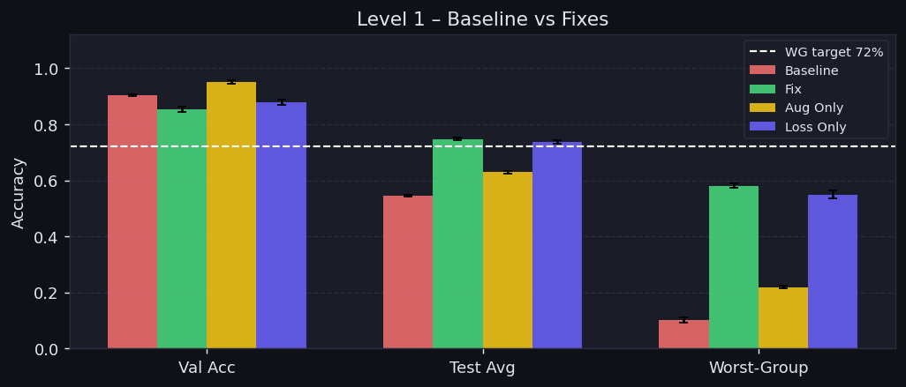

*Grad-CAM Before Fix (Model focuses on tinted background):*  
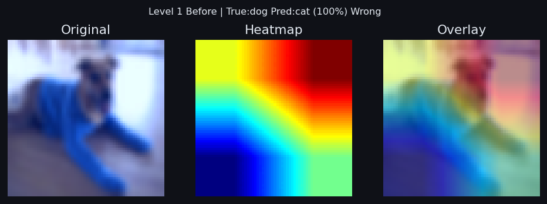

*Grad-CAM After Fix (Model shifts attention to object features):*  
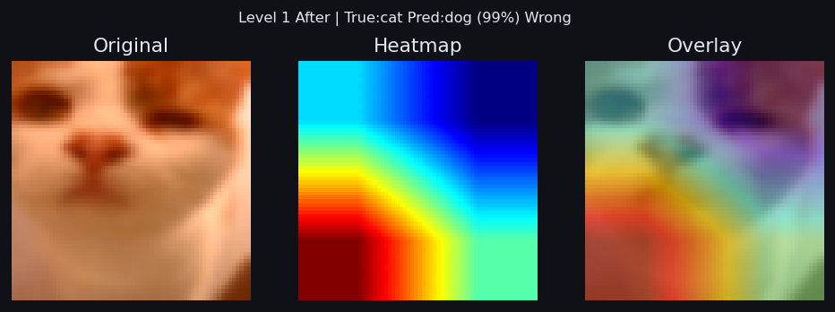

---

### Level 2: Corner Patch
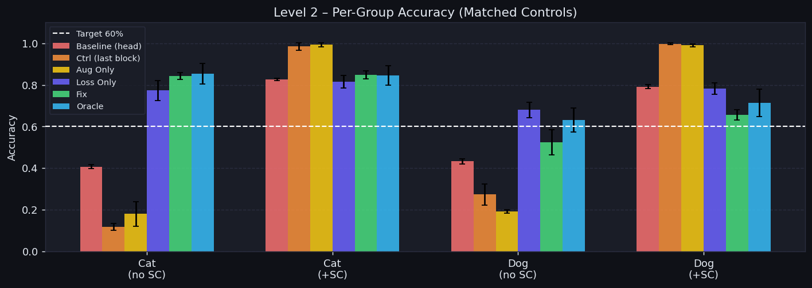
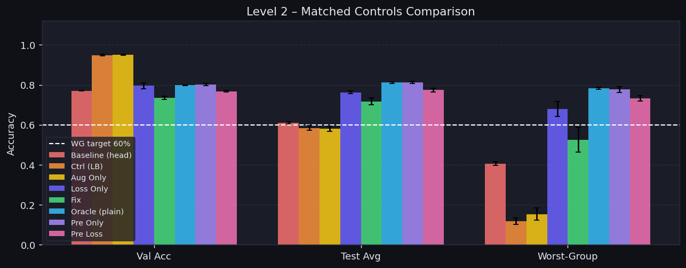

*Grad-CAM Before Fix (Model fixates on the top-left color square):*  
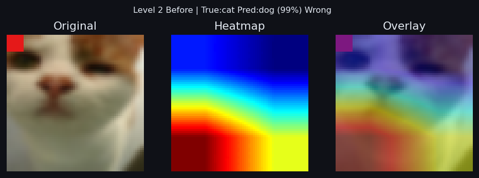

*Grad-CAM After Fix (Attention restored to animal contours):*  
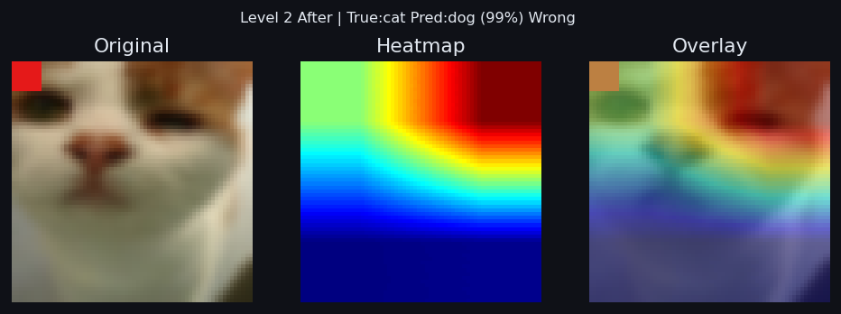

---

### Level 3: Stripe Texture
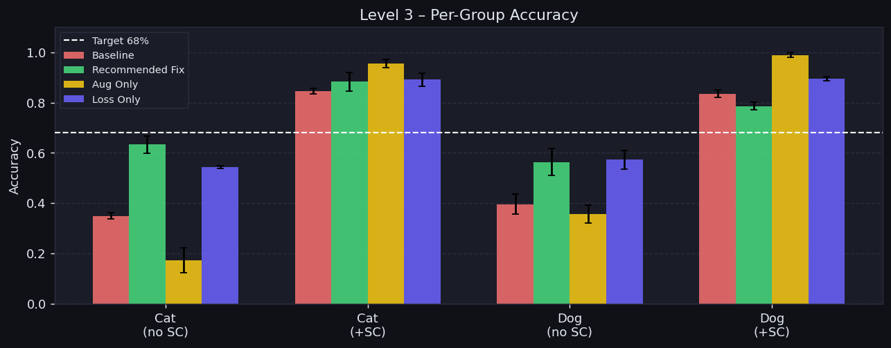
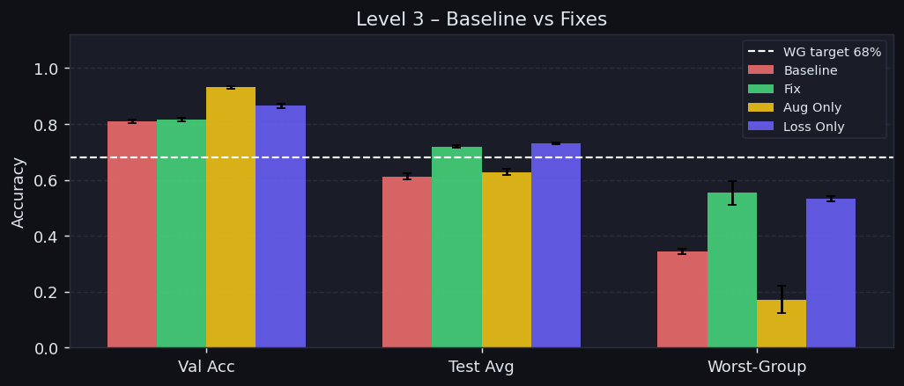

*Grad-CAM Before Fix (Focus on stripe pattern artifacts):*  
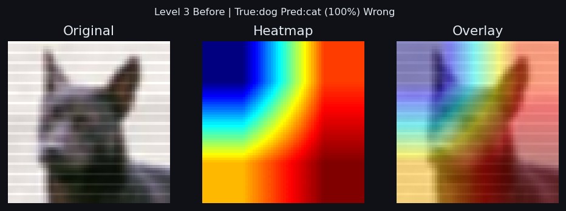

*Grad-CAM After Fix (Attention invariant to overlay texture):*  
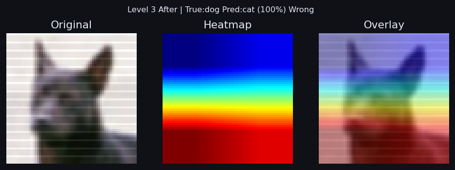

---

## Limitations

- **Group Label Requirement**: The group-reweighted loss uses group labels (true class × shortcut presence). In unconstrained real-world settings, group labels are rarely available without explicit metadata or unsupervised discovery.
- **Synthetic Shortcuts**: The shortcuts (color tints, corner patches, and synthetic stripe grids) are artificially planted to provide clear pedagogical contrasts. Natural shortcuts (e.g. background grass, camera watermarks) are more subtle and multimodal.
- **Image Resolution**: CIFAR-10 images are upscaled to 64×64. Due to low native resolution, Grad-CAM heatmaps at `layer4` are coarse.
- **Binary Classification**: The demonstration uses a 2-class subset (cat vs dog) to ensure fast CPU-bound training runs under ~3 minutes.

---

## How to Run

### 1. Installation
```bash
pip install -r requirements.txt
```

### 2. Launch the Streamlit App
```bash
streamlit run streamlit_app.py
```

### 3. Reproduce Experimental Results
To rerun the full matched-controls empirical evaluation and regenerate all figures:
```bash
python results.py
```

### 4. Run the Test Suite
```bash
python tests/test_basics.py
pytest tests/ -v
```

<a id="test-status"></a>
**Test Status**: All 33 automated unit and integration tests passing (`24/24` basic checks + `9/9` game loop tests).

---

## Memory Budget & Resource Profile

Measured on CPU via `python measure_memory.py` using `psutil` process RSS (uint8 dataset storage, from `results/memory.json`):

| Operation | Peak RSS |
|---|---|
| Import torch + streamlit | 222.9 MB |
| Dataset Load (Level 1) | **529.1 MB** |
| head_only training run | 304.5 MB |
| last_block training run | 504.0 MB |
| full training run | 516.2 MB |
| Grad-CAM | 314.8 MB |

Dataset tensors are stored as **uint8** (3×64×64 per image) and converted to float32 per batch in the collate function — peak RSS is from the initial CIFAR-10 array concatenation, not from holding float32 images.

---

## Player Controls Guide

### Fine-Tuning Depth
- `head_only`: Fast training, freezes all ResNet layers except the final linear classifier. Max 4 epochs in the app.
- `last_block`: Unfreezes `layer4` + FC layer. Allows high-level feature extraction adjustments. Max 2 epochs.
- `full`: Unfreezes all layers. Max 1 epoch.

### Augmentations
- **ColorJitter**: Randomizes brightness, contrast, saturation, and hue (counters Level 1).
- **RandomGrayscale**: Removes chromatic information (counters Level 1 & Level 2).
- **RandomResizedCrop**: Displaces and crops parts of the image (counters Level 2).
- **RandomErasing**: Randomly occludes image patches (counters Level 2).
- **Gaussian Noise**: Adds tensor noise to disrupt high-frequency patterns (counters Level 3).

---

## Repository Structure

```
clever_hans_hunter/
├── streamlit_app.py       – Streamlit UI with full game loop, diagnostics, and training
├── data.py                – CIFAR-10 dataset builder, shortcut injection, group IDs, LEVEL_TARGETS
├── model.py               – Pretrained ResNet18 wrapper with freeze modes
├── train.py               – Training engine, augmentations, loss functions, and metrics
├── gradcam.py             – Hook-based Grad-CAM implementation
├── results.py             – Multi-seed matched-controls evaluation with Wilson CIs
├── measure_memory.py      – RAM profiling script
├── requirements.txt       – Pinned dependencies with PyTorch CPU wheel index
├── LICENSE                – MIT License
├── .streamlit/
│   └── config.toml        – Headless configuration and telemetry settings
├── checkpoints/           – Pre-trained baseline checkpoints (level1/2/3_baseline.pt)
├── data/
│   └── cifar_catdog.npz   – Pre-built cat/dog subset (17.5 MB, seed=42)
├── weights/
│   └── resnet18_imagenet.pth – Cached ImageNet weights (44.7 MB, no download on cold start)
├── docs/                  – Generated evaluation figures and Grad-CAM comparisons
├── results/
│   ├── memory.json        – Memory profiling data
│   └── results.json       – Empirical metrics across all seeds and conditions
└── tests/
    ├── test_basics.py     – Sanity checks for data, shapes, and shortcuts
    └── test_game_loop.py  – Unit tests for game loop functions
```

---

## The Clever Hans Story

In the early 1900s, a horse named **Clever Hans** appeared to perform arithmetic by tapping his hoof. He succeeded in front of large crowds—until psychologist Oskar Pfungstadt demonstrated that Hans was not performing arithmetic at all. Instead, he was observing subtle, involuntary physical cues and tension changes from the human examiner.

Deep neural networks regularly exhibit Clever Hans behavior: when an unintended spurious feature correlates with the label in the training set, the network will exploit that shortcut rather than learning causal semantic features. **Worst-group accuracy on counter-shortcut distributions exposes this failure.**
